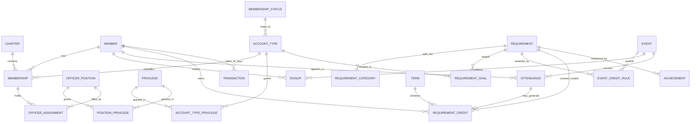

# What the system needs to store

> Summary: The things a chapter tracking system stores and how they connect, corrected
> against the real APOonline site. The four big decisions at the top still hold; three of
> them now have direct evidence behind them, and one was wrong.
> Status: OBSERVED (every claim cites a file in raw/; design recommendations are marked)
> Read this if: you are designing the database or want to understand the data.
> Depends on: docs/GLOSSARY.md, docs/02-data-model/01-how-the-vendor-differs.md

This document was first written from APOonline's public marketing page. It has now been
checked page by page against the real site with an admin account. Claims are marked
`[observed]` with the file that shows it, or `[inferred]` with the reasoning.

## A few words you need first

**Entity.** A kind of thing the system stores. Member, event and term are entities. Each
entity usually becomes one database table.

**Field.** One piece of information about an entity, such as a member's phone number.
Each field usually becomes one column.

**Join table.** A table whose job is to connect two other tables. If members attend
events, you need a third table with one row per member per event.

## The four decisions that shape everything else

### 1. Terms come first. Confirmed, with a twist.

A term is one semester, such as Fall 2026. Progress, reports and goals are all measured
inside a term.

`[observed]` The real site does not keep a list of named terms. It stores a repeating
month and day for the start of each term, and works out the current term window from
that. On this chapter the setting is "semester", term one begins December 20 and term two
begins June 20 (`raw/pages/memberhome_action-setterm.md`). Every progress screen then
shows a window: the service report header reads "Begin Date: June 20th, 2026 / End Date:
December 19th, 2026" (`raw/pages/memberhome_action-managerecords_reqid-3.md`), and the
officer dashboard says "December 19th marks the end of current term and the beginning of
next" (`raw/pages/memberhome_action-managemenu.md`).

**Recommendation `[design]`: keep a real `term` table anyway.** A named row with a start
and end date is easier for students to reason about, easier to query, and lets a chapter
fix a term that started late. Generate the rows from the chapter's calendar setting; do
not compute the window on every page.

### 2. Permissions are data, not code. Confirmed, and there are two sources, not one.

`[observed]` The site stores permissions as checkbox grids, exactly as hoped. But it has
**two** separate grids:

- one per officer position, 39 privileges (20 access, 19 requirement)
  (`raw/pages/memberhome_action-editofficerprivileges_officerid-2892.md`)
- one per account type, 40 privileges (7 event, 16 access, 17 record)
  (`raw/pages/memberhome_action-editprivileges_statusid-2.md`)

The earlier guess that permissions come only from officer positions was **wrong**. What a
plain member can do (sign up for events, see the roster, post a photo, log their own
hours) is set by their account type. What an officer can do (manage a requirement, send
bulk e-mail, configure the site) is set by their position. See
`docs/04-system-design/02-auth-and-permissions.md`.

### 3. Requirements are data too. Confirmed, and richer than expected.

`[observed]` A requirement on the real site carries a label, a unit label, a flag for
percentage instead of a count, a flag for whether outside credit counts, optional
categories, and a target **per account type** with a separate cap for outside credit
(`raw/pages/memberhome_action-createrequirement.md`). Targets can be fractional: this
chapter sets 7.5 service hours for its "Half-Active" account type
(`raw/pages/memberhome_action-editrequirement_reqid-3.md`).

### 4. Attendance and credit are two different things. Confirmed.

`[observed]` A credit can exist with no event at all. The manual credit form sends only
`userid`, `title`, `date`, `units`, an optional category and an internal-or-external flag.
It sends no event id (`raw/pages/memberhome_action-viewrecords_reqid-3.md`).

`[observed]` One event can produce several credits for the same person. A notification
reads "For attending GBM #5: Business Casual you've been credited with: 1 Meeting, 1
Required Event" (`raw/pages/memberhome_action-viewnotifications.md`).

`[observed]` Credit is not created by signing up. It is created when an officer completes
the event: "Completing events awards each attendee credit for attending the event"
(`raw/pages/memberhome_action-pendingevents.md`).

## The entities

### Term
One semester or quarter. Has a name, a start date and an end date.
`[observed]` The vendor stores only the recurring boundary dates, not a row per term.

### Member (a person)
`[observed]` The report builder names the member fields the server actually keeps, as
checkbox values: `id, fullname, firstname, nickname, middlename, lastname, suffix,
maidenName, memberNumber, chapternumber, email, email_public, phone, birthday, pledgeclass,
graduationclass, homeaddress, campusaddress, dateRegistered, dateLastLogin, status`
(`raw/pages/buttons-and-dropdowns.md`). Two of them, **`dateRegistered` and
`dateLastLogin`**, appear on no edit form: the system sets them.

Lasts across many terms and across chapters. `[observed]` The profile form holds first,
middle and last name, suffix, nickname, maiden name, login e-mail, contact e-mail, phone,
campus address, home address, major, gender, pledge class term and year, graduation class
term and year, birthday, a short "about me", and a national id number
(`raw/pages/memberhome_action-managebrother_panel-account.md`).

`[observed]` A person is separate from their chapter membership. The member's own profile
editor has a section headed "Affiliations" which reads "ALPHA DELTA  This is <name>'s
primary affiliation" and gives that affiliation its own account type and chapter id
(`raw/pages/completeness-pass.md`). The add-member page says transfer students "may already
be in the system", and the member number field is keyed by chapter (`chapternumber[311]`)
(`raw/pages/memberhome_action-inviteuser.md`). So one person, many affiliations, one marked
primary.

`[observed]` **Profile values are versioned, not overwritten.** The profile editor states:
"To maintain profile history, any updated values are saved. To delete past information you
may clear your profile history." (`raw/pages/completeness-pass.md`) That is also what the
audit-log line "Cleared profile history" refers to
(`raw/pages/memberhome_action-viewlog.md`).

`[observed]` **Every profile field carries its own audience**, one of five on the built-in
field editor: "Anyone", "Anyone + Staff", "Alpha Delta Only + Staff", "Officers", "Hidden
(Staff Only)". "Staff" means the vendor's staff, not the chapter's officers
(`raw/pages/completeness-pass.md`).

`[observed]` **The custom-field builder shows the fuller model** each field definition uses
(`?action=createuserfield`, `raw/pages/unread-routes-sweep.md`). A field definition has:
a **type** (General Text, E-mail, Phone, Website, Yes/No, Date, Date & Time, Selection
Drop-Down, Multi-Selection); a **unique** flag (require the value be unique across all
member profiles); a **usage** of public profile field OR private officer-only notes field
(hidden from members); an **importance** of Optional, Recommended, or Required, where
Recommended and Required also place the field on the public registration form; a
**membership-status scope** (all statuses, or only some); a **merge code** `{{member:...}}`
for email templates; and, most importantly, **two separate ACLs, one for viewing and one
for editing**. The view ACL has finer options than the built-in five (for example "Only
Region B members", "Only Alpha Delta members excluding Potential New Members", "Only the
member"), and the edit ACL is independent ("the member and their officers/advisors", "only
officers/advisors", with an "all staff may also edit" add-on). `[design]` For the rebuild,
a profile field definition should carry { type, unique, usage(public|officer-notes),
importance(optional|recommended|required), status-scope, view-scope, edit-scope }, and view
and edit permission must be stored separately, not as one visibility flag.

### AccountType (the chapter's own membership categories)
`[observed]` System account types are locked three ways, not one. Editing the system type
"Active" shows the notice "The name of this account type cannot be modified because it is a
system default account type", the name input is disabled, the national-status select is
absent altogether, and there is no delete link. A custom type has all three
(`raw/pages/full-read-pass-2.md`). The proposed schema's `is_system` flag should therefore
prevent renaming, remapping and deletion.

`[observed]` Chapters use both a shared list and their own. This chapter has ten shared
types (Prospect, Officer, Active, Potential New Member, Associate, Advisor, Alum,
Honorary, Inactive, Deceased) and four of its own under the heading "Custom Local Account
Types (Alpha Delta Only)": Bad Standing, Leave of Absence, Half-Active, System
(`raw/pages/memberhome_action-managestatuses.md`). Each has a singular and a plural label.

### MembershipStatus (the national categories)
`[observed]` Every account type maps to one of six national statuses: Active, Alumni,
Deceased, Inactive, PNM, Prospect.

`[observed]` A release note from March 2020 announces a seventh, "Guest", created so that
donors could be stored as member records
(`raw/pages/whatsNew-full-read.md`). It is not in the live dropdown, which offers six. The
two observations conflict and are not resolved here; see `docs/GAPS.md`. The edit form explains why, verbatim: "a custom Account
Type of 'Studying Abroad' would still officially be recognized as an 'Active' member"
(`raw/pages/memberhome_action-editstatus_statusid-111.md`).

### Membership (one person in one chapter)
Holds the account type, the chapter member number, and the officer positions held.

`[observed]` The Account Manager states the person/membership split outright: "If you remove
someone and they have an account with another APOonline website, only this chapter's data
will be removed but their account will still be active on their other sites."
(`raw/pages/managebrother-all-panels.md`)

`[observed]` Changing a member's account type by hand carries a **reason** (`reasons[N]`)
and a choice of whether to notify the member (`notify[N]`), and the page warns it is for
"manual status overrides" only, directing officers to the Transition tool otherwise. So the
product distinguishes correcting a mistake from recording a real change of standing.
`[observed]` The account type is stored once as a current value, not as a row per term: the
roster groups people by their current type only (`raw/pages/memberhome_action-brothers.md`).
Past types are not lost, though. They are kept as dated **"Membership Status Change"**
entries on the member's activity Timeline, for example "Transitioned to an 'Advisor:
Chapter Advisor'" with a date (`raw/pages/gap-resolution-2.md`, `raw/pages/profile-panels.md`).
So the product has account-type history as a change log, not as a per-term membership row.
An earlier version of this paragraph said no screen showed any history; that was wrong and
is corrected here. Confidence: high. The per-term `membership` row in the proposed schema is
still the recommended design, because a change log cannot answer "who was Active in Fall
2025" as directly as a row per term can.

### OfficerPosition
`[observed]` Chapter-defined, with a title (max 75 characters) and a flag for officer,
advisor or both. This chapter has 18 officer positions and 1 advisor position. The
President row has no delete link, so at least one position is protected
(`raw/pages/memberhome_action-editofficerpositions.md`).

### Privilege
`[observed]` A fixed list built into the product, in three groups for account types
(Event, Access, Record) and two groups for positions (Access, Requirement). The complete
lists are in the two raw privilege files. Some privilege keys are stored inverted: the
"Allow" column for "View roster and profiles of other members" sends
`priv[hideMembers]=false`.

### Requirement (which is also an event type)
`[observed]` The requirement admin page is headed "Event Type"
(`raw/pages/memberhome_action-managerequirements.md`), the officer dashboard link reads
"create event type and corresponding requirement progress bar"
(`raw/pages/memberhome_action-managemenu.md`), and the same numeric id is used for both
throughout the site. In this product a requirement and an event type are one record.

### RequirementCategory
`[observed]` Optional sub-parts of a requirement. Service Project (id 3) is split into
Service to the Campus, Community, Nation and Fraternity, with ids 1 to 4
(`raw/pages/memberhome_action-editrequirement_reqid-3.md`).

### RequirementGoal
`[observed]` One target per requirement per account type, with two numbers: an internal
target and a maximum that may come from outside events
(`raw/pages/memberhome_action-createrequirement.md`). When a requirement is split, there
is also a goal per category per account type.

### Event
`[observed]` An event with a limit keeps a **waitlist**. Nothing on the event screens shows
this; it is visible only as a notification switch, "...when I am promoted from a waitlist"
(`notify[waitlist]`), which pairs with `eventinfo[maxattendees]` on the event form
(`raw/pages/partials-closed.md`). So reaching the limit does not refuse a sign-up, it
queues it.

`[observed]` Title (max 255), start and end date and time, all-day flag, shifts, location
with latitude and longitude, description, maximum attendees, sign-up open, lock and close
times, up to two coordinators, a ride requirement, visibility level, sign-up level,
attendee-list visibility, invitations to other chapters, and an optional event group
(`raw/pages/memberhome_action-eventcreate.md`).

`[observed]` A repeating event is stored as several separate events, one per date. The
access log shows five events created one second apart with five different ids
(`raw/pages/memberhome_action-viewlog.md`).

### EventCreditRule
`[observed]` One row per credit an event awards: an amount, a requirement (and category),
and a flag for whether the amount is per shift or per event
(`raw/pages/memberhome_action-eventcreate.md`). An event can have several.

`[observed]` An event can also have **none**. The create form's default state reads "This
event will not count towards any requirement", the calendar has an eighteenth filter called
"Other Events" alongside the seventeen requirement filters, and there is an officer
privilege called "Manage Other (Non-Associated) Events"
(`raw/pages/completeness-pass.md`,
`raw/pages/memberhome_action-editofficerprivileges_officerid-2892.md`). So the link between
events and requirements is optional in both directions, which is another reason to keep it
as its own table.

### Signup and attendance
`[observed]` A sign-up is a row that is created and deleted, and it carries more than the
fact of signing up: the access log records a member signing up "as a driver with 8 open
seats" (`raw/pages/memberhome_action-viewlog.md`), and the event page's attendee table has
the columns "Member | Phone | Comment", so a member can leave a note with their sign-up
(`raw/pages/diamond-features-how-they-work.md`).

`[inferred]` The site does not appear to keep attendance as a separate record from the
sign-up. The event page calls the same list the sign-up sheet and the attendee list, the
event page offers "Manually add member" to that one list, and the attendance report offers
"Only show attendees with positive hours of attendance"
(`raw/pages/memberhome_action-eventsignup_eventid-1152799.md`,
`raw/pages/memberhome_misc-surfaces.md`). Confidence: medium. Nothing was found that
records "signed up but did not come". **Recommendation `[design]`: keep them separate
anyway.** See `docs/02-data-model/01-how-the-vendor-differs.md`.

### RequirementCredit
`[observed]` Holds the member, the requirement, an optional category, an amount, a date, a
free-text title, and a flag for internal or external
(`raw/pages/memberhome_action-viewrecords_reqid-3.md`).

### Money: transactions, invoices, budgets
`[observed]` Dues are modelled two ways at once. There is a requirement called "Dues &
Fees" with id 1 that appears as a progress bar, and there is a real ledger with columns
"Date | Payer/Payee | Memo | Type | Amount Paid | Fees | Amount Received"
(`raw/pages/memberhome_action-viewtransactions.md`), a per-member balance screen
(`raw/pages/memberhome_action-managedues.md`), invoices, and a budget per officer position
(`raw/pages/memberhome_action-managebudget.md`).

`[observed]` **An invoice has a status with four values: Open, Pending, Paid, Void.** The
per-member Invoices panel filters by exactly those four (plus "All"), with columns Invoice,
Due Date, Total, Actions (`raw/pages/self-flows-observed.md`, Flow E). So an invoice is a
row per member with a due date, a total, and a status moving through that small set. Invoice
creation is a chapter-level finance action, not a self-service one, and was not run.

`[observed]` **The Dues requirement (reqid 1) is a special requirement that carries the
dues definition itself**, not a generic one (`raw/pages/unread-routes-sweep.md`, from its
edit form). On top of the normal per-account-type goal and progress bar, it has: a
**three-way split** of each dues amount into Chapter Dues, Region Dues (sent to Region B),
and National Dues (sent to the National Office); a **due date and time** shown on the member
homepage until paid; an **automatic late fee** toggle ("assessed on the due date"); and an
**accept-online-payments** toggle. So dues unify the requirement model (a goal per account
type, a progress bar) with the finance model (the split, the due date, the late fee, online
payment). `[design]` For the rebuild, model dues as its own thing that also drives a
progress bar, rather than as a plain requirement; the chapter/region/national split is a
national-hierarchy concern a single chapter can simplify to one destination.

`[observed]` The operator confirmed (2026-08-30) that this chapter has never used the
**automatic late fee** or the **online payment** feature. Both toggles exist, but no late
fee has ever been assessed here and no dues have been paid online, so their runtime behavior
is unobserved and cannot be checked on this chapter. Payments are recorded by an officer by
hand (cash, check, card, other). `[design]` A single-chapter rebuild can drop online card
payment and automatic late fees at the start and add them only if the chapter asks.

### ChapterAward, which is not the same as a member award
`[observed]` The chapter's own Awards tab has five sections: "Official Awards" (given by
staff at national, Region and Section level), "Chapter Distinguished Service Keys", "Other
Awards", "Trophies", and "In The News"
(`raw/pages/full-read-findings.md`). These belong to the chapter, not to a member, and the
official ones are granted from above the chapter. `[design]` SKIP.

### Achievement and Award
`[observed]` An achievement has a title, a description, and either an automatic condition
(N units of a named requirement, within a term or a lifetime) or manual granting
(`raw/pages/memberhome_action-createchapterachievement.md`). An award has a name and a
description, and is granted through a ballot with eligible account types and optional
write-ins (`raw/pages/memberhome_misc-surfaces.md`).

### Employer
`[observed]` A member's work experience links to an employer record, not a free-text
string: the form carries `company` (typed), `companyId` and `companyName` (hidden), the
same resolve-as-you-type pattern the site uses for members
(`raw/pages/partials-closed.md`). That is what makes the alumni directory's "search by
employer" work. `[design]` SKIP for one chapter.

### Line, and big/little
`[observed]` **The word "Line" is this chapter's own label, not the product's.**
`?action=editfamilysettings` lets a chapter choose "Family / Families", "Group / Groups", or
a custom pair; Alpha Delta set the custom singular to "line" and plural to "lines"
(`raw/pages/full-read-findings.md`). The Big and Little labels are configurable the same
way, with "Parent / Child" offered as an alternative. So the entity is a **family/group**,
and what a chapter calls it is a setting.

Membership in a named line/family is optional; this chapter has none, and 72 members sit in
a "No line listed" group
(`raw/pages/memberhome_action-managefamilies.md`, `raw/pages/memberhome_misc-surfaces.md`).

`[observed]` **But big/little lineage is a separate thing, and it IS populated.** The public
family tree at `familytree.php` renders a full big/little tree for the chapter with many
members in it (`raw/pages/unread-routes-sweep.md`). So the two features are independent: the
named group ("line"/"family") is unused here, while the big/little relationships that the
`lineage` join table models are in active use and drive the family-tree view. An earlier
note assumed the tree would be empty "because the chapter has no lines"; that conflated the
named group with the lineage relationships. The `lineage` table is therefore exercised by
real data, and the named line/group stays an optional, currently-unused layer on top.

`[observed]` **A member can have more than one big and more than one little.** The Account
Manager's Family panel says so in its own words: "If they have more than one big member or
little member select each individually from the boxes on the right." There are separate
forms for adding one big (`bigid`) and one little (`littleid`), each adding one at a time
(`raw/pages/managebrother-all-panels.md`).

This corrects the original guess. The first schema used a single `member.big_member_id` and
noted that a second big would need its own table. It does. The schema now has a `lineage`
join table.

`[observed]` A member's own profile shows **three** groups: "Big Members", "Siblings" and
"Little Members" (`raw/pages/full-read-pass-2.md`). Only bigs and littles can be entered;
**siblings are derived** from members who share a big. So one `lineage` table produces all
three views, and siblings should be a query, never a stored row.

`[observed]` **"Personal Family" is a different thing from a Line.** It records a member's
real relatives, who need not be members, with a relationship chosen from Mother/Father/
Guardian, Spouse, Sibling, Child, Cousin, Aunt/Uncle, Niece/Nephew, or free text, plus a
name, e-mail and phone (`raw/pages/managebrother-all-panels.md`). `[design]` SKIP.

### Activity (the member Timeline)
`[observed]` A member has a **Timeline**, an activity log separate from both the audit log
and the profile-field history (`?action=profile&panel=timeline`,
`raw/pages/gap-resolution-2.md`). Each entry has a date, an activity type, a sentence, and
an actor ("Added by <name>"). Types seen: **Membership Status Change** (this is how the
product records account-type history, for example "Transitioned to an 'Advisor: Chapter
Advisor'"), **Received Award**, **Unlocked Achievement**, **Elected Officer Position**, and
account creation. A "Log Activity" form lets an entry be added by hand.

`[observed]` **The Timeline is written independently of the records it names, and is not
walked back when one is deleted.** After a member award was deleted, its "Received Award"
timeline entry remained until it too was deleted by hand (each row has its own delete,
`subAction=deleteActivity`). This is the same shape as deleting an event, which leaves the
credit and notification it created in place. `[design]` For the rebuild this argues for
treating an activity feed as a derived/append log, and for deciding deliberately whether
deleting a source record should also retract its activity entry (the vendor does not).

### NotificationPreference
`[observed]` Each member has notification preferences (`?action=contactPreferences`,
`raw/pages/unread-routes-sweep.md`): which e-mail address to use (login or contact); a set
of per-activity toggles, some carrying a lead time (a weekly Sunday digest; an event
reminder with a lead time from "1 hour before" to "1 week before"; when attended-event
hours are reported; when a private message arrives; when promoted from a waitlist; when the
member's account type changes); and a consent matrix of source (National, Region, Chapter)
crossed with channel (Email, Call, Text, Paper Mail). `[design]` A single chapter can
collapse the three sources to one, keep the per-activity toggles (they map onto the
notifications the system already sends), and drop the channels it does not use. This page is
also where two features are confirmed that appear nowhere else directly: events have a
**waitlist**, and an **account-type change fires a notification**.

### AuditLog
`[observed]` Every entry records who acted (name and user id), a sentence naming the
affected records and their ids, and a timestamp
(`raw/pages/memberhome_action-viewlog.md`).

## How they connect

Read `||--o{` as "one of these connects to many of those".

`ATTENDANCE` is in this diagram as a recommendation, not as something the vendor was
observed to keep separately. See the note under Signup and attendance.

## Whole features documented but kept out of the core model

These are real features on the platform, read in full (`raw/pages/unread-routes-sweep.md`),
but they are not part of the core single-chapter schema. They are recorded so nothing is
silently omitted, with a lean on whether a single chapter needs them.

- **Forms** (`createform`): a form builder (audience, scheduling, anonymous option) whose
  questions use a 13-type answer enum, including "Single/Multiple Members" and "Member Field
  to Update" (a form answer can write back into a profile field). Entities: Form, Question,
  Section, FormSubmission. `[design]` Genuinely useful even for one chapter (data collection
  and bulk profile updates); LATER, not never.
- **Courses** (`createCourse`): an LMS-style feature. A Course has modules (sequential or
  any order), a completion frequency, an audience filter, and an optional downloadable
  certificate. Entities: Course, Module, Certificate. `[design]` LATER/optional.
- **Job Board** (`viewJobs`) and **member messaging** (`viewmessage`): alumni networking and
  private member-to-member messages. `[design]` SKIP for a single active chapter.
- **Donations / fundraising** (`createFund`, `myDonations`): funds, campaigns, and donations
  typed as cash / non-cash gift / soft credit, optionally mirrored into the ledger.
  `[design]` SKIP (alumni/development scope).
- **Store** (`manageStore`): plan-gated and not enabled on this chapter, so unread.
  `[design]` SKIP.

## What we left out on purpose

APOonline serves many chapters, grouped into sections and regions, with a national office
above them. `[observed]` The chapter page shows "Group Type: Chapter" and "Region:
Region B", the navigation offers a region and a national calendar, and event visibility
can be set to "Only members in Region B" or "Any Alpha Phi Omega member"
(`raw/pages/memberhome_action-viewchapter_id-311.md`,
`raw/pages/memberhome_action-eventcreate.md`).

You are building for one chapter, so none of that is here. Dropping it removes a large
amount of work.
