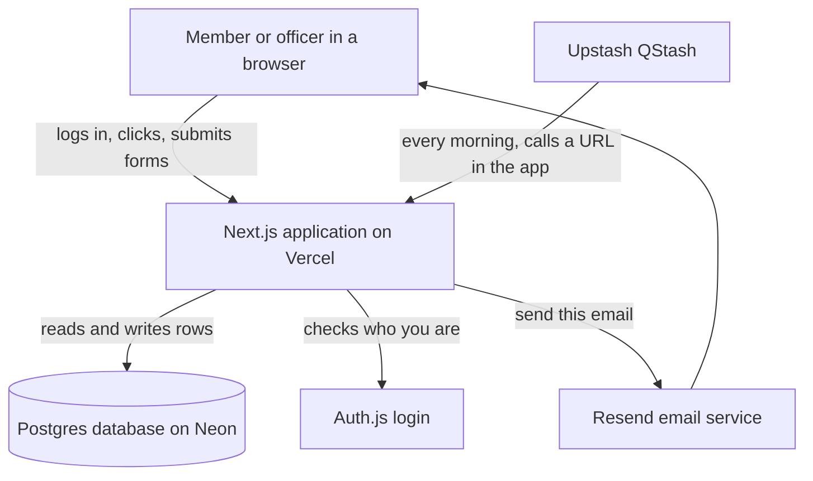

# How the rebuilt system fits together

> Summary: The rebuilt system is one Next.js application talking to one Postgres
> database, with an optional scheduler for reminder emails. This document shows the
> pieces and how a request flows through them.
> Status: DESIGN (our recommendation for the rebuild, not the existing site)
> Read this if: you are about to start building, and want the shape of the system.
> Depends on: docs/02-data-model (what to store), docs/05-rebuild-plan/02-stack.md (tools)

## The whole system in one picture

Most of the system is the middle line: a browser talks to one application, and that
application reads and writes one database. The login piece, the scheduler, and the email
sender are supporting parts. The scheduler and email sender are not needed until you
build reminders.

## The pieces

**The Next.js application.** This is almost the entire system. It draws the pages, shows
the forms and tables, and contains all the rules about who can do what. In Next.js, most
pages are built on the server and sent to the browser as finished HTML, so the browser
runs very little code. This suits a system that is mostly forms and tables.

**The Postgres database.** One database holds everything: members, terms, events,
attendance, credits, dues. The tables and their rules are defined in
`docs/02-data-model/proposed-schema.sql`.

**Auth.js.** Handles logging in. When someone logs in, the application learns which
member they are, and from that, which officer positions they hold this term, and
therefore what they are allowed to do.

**The scheduler and email sender.** Only for reminder emails, a LATER feature. The
scheduler calls the application on a timer. The application figures out who needs a
reminder and asks the email service to send it.

## How one request works

Take a common action: an officer records that a member attended an event.

1. The officer is on the event page and clicks "mark present" next to a member.
2. The browser sends that request to the application.
3. The application checks the login: who is this, and do they hold a position this term
   that includes the "take attendance" privilege? If not, it stops here and refuses.
4. The application writes one row to the attendance table.
5. If attending this event earns credit, the application also writes a row to the credit
   table, linked back to that attendance row.
6. The application sends back the updated page.

Step 3 is the important one, and it is covered next.

## Where the rules live

Every rule about who can do what runs on the server, inside the application, before it
writes anything. This is not optional and it is not decoration.

The reason: the browser cannot be trusted. A page can hide a "delete member" button from
someone who lacks permission, but hiding a button does not stop a determined person from
sending the delete request directly. The only place a rule cannot be bypassed is on the
server, because the server is the one thing the user does not control.

So the design is: hide buttons in the page for a clean experience, and independently
check every rule on the server for actual safety. The server check is what matters. The
hidden button is a convenience.

Concretely, every action that changes data starts with the same check: "does the logged
in member hold a position this term that grants the privilege this action requires?" One
shared function does this check, and it runs first, every time.

## Why it is this simple

A system for one chapter of under 50 people does not need more than this. There is no
second database, no separate service for each feature, no message system passing data
between parts. One application and one database is easier to build, easier to understand,
easier to fix, and cheaper to run.

Adding pieces before you need them is the most common way student projects stall. The
right time to split something out is when a real, measured problem forces it, and for a
chapter this size that time will not come.

## What runs on a schedule

Almost nothing in this system runs on a timer. It reacts to clicks. The one exception is
reminder emails, which need something to wake the application up each morning. That is the
scheduler's only job. Everything else happens because a person did something.
